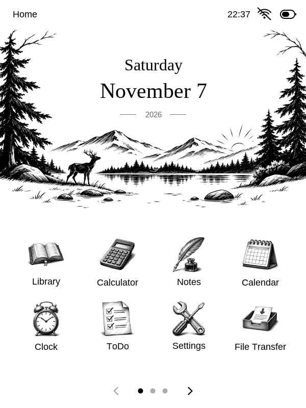
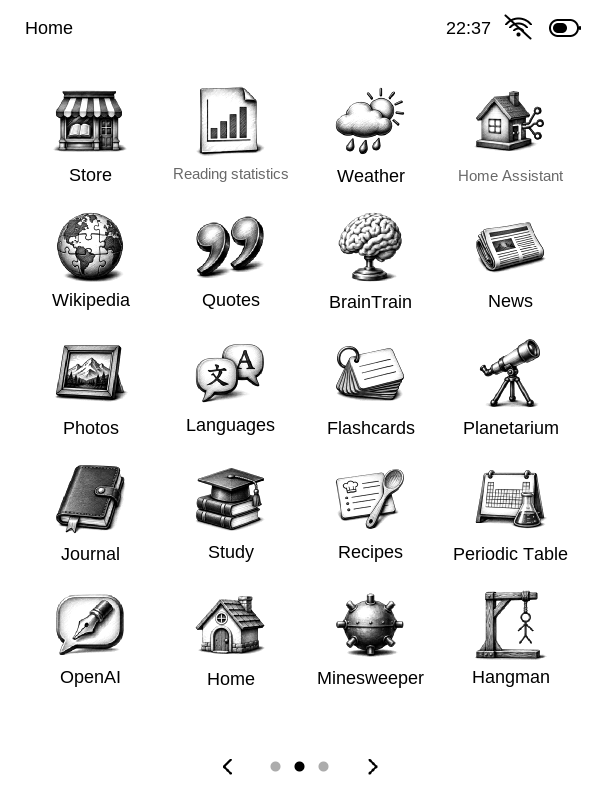
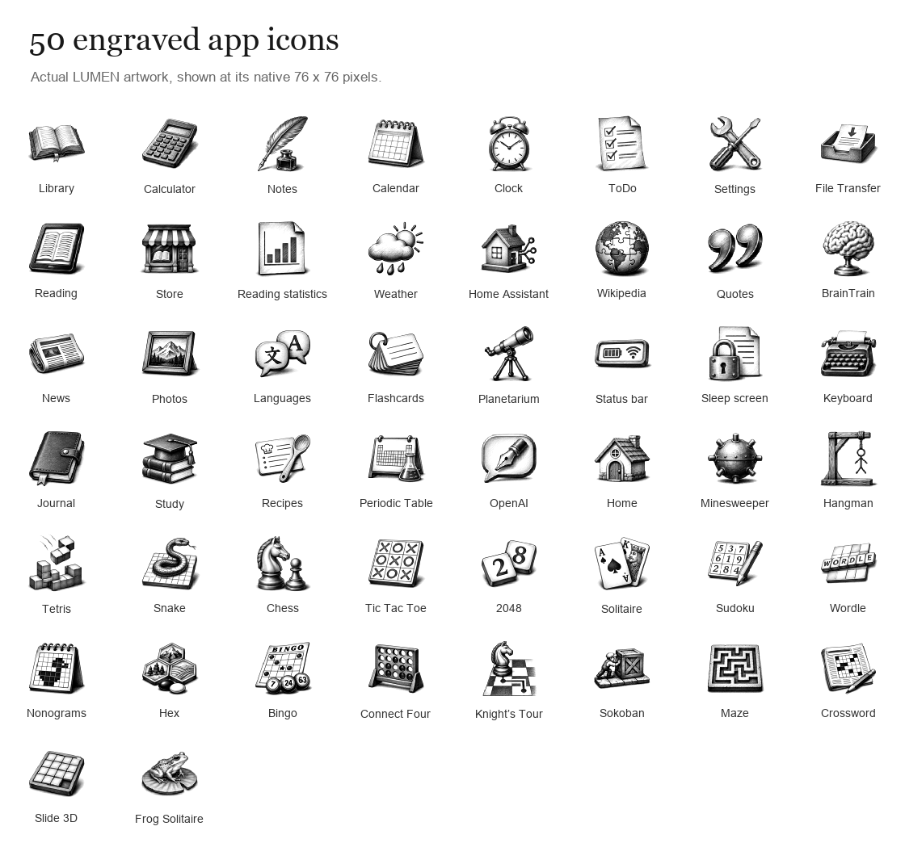
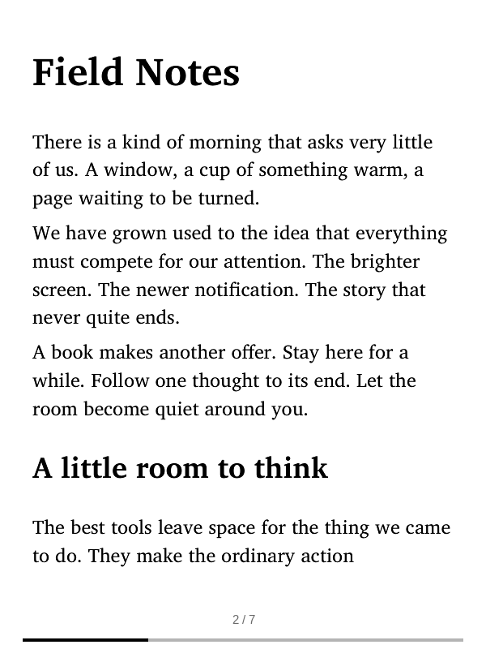
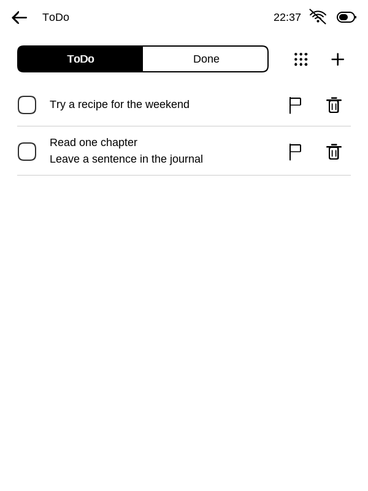
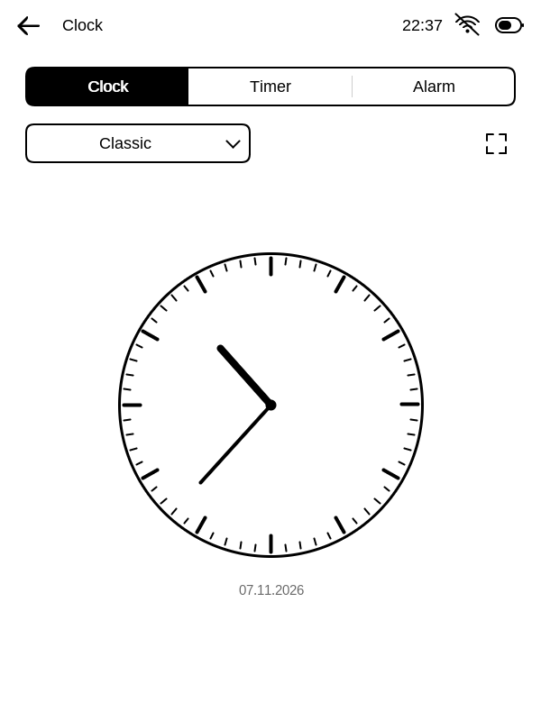

# LUMEN

### A calm personal computer for your Kindle.

An illustrated Home, a shared Reader, and useful tools for a paper screen.

[**Download 3.9**](https://github.com/MerlinHof/Lumen/releases/tag/v3.9) ·
[Release notes](docs/releases/3.9.md) ·
[Installation](docs/installation.md) ·
[Build](docs/building.md) ·
[Agent guide](AGENTS.md)

**Native C · 600 × 800 E-Ink · Local first · Deutsch / English / Français**

## A little room for your day

Home opens with the date, an engraved landscape and the tools you use most.
The first eight apps share the same grid as the pages that follow. Fifty
illustrated app icons are drawn as small physical objects, with deep blacks
and open white space. Classic icons remain available in Appearance.

<table>
<tr>
<td width="50%" align="center"> <strong>Home</strong> A quiet beginning, with everything within reach.</td>
<td width="50%" align="center"> <strong>Your tools</strong> The same grid continues across full app pages.</td>
</tr>
</table>

<strong>See all 50 engraved icons</strong>

 

## Read, write, think

Your library has Continue Reading, covers, authors, pinned books and saved
progress. Reader preferences apply to books and the shared reading view for
articles, recipes, Markdown notes and model answers.

Notes combines folders, text and drawing. ToDo keeps flagged items at the top
and lets a checked task remain visible for the current session. The calculator
offers editable formulas, scientific functions, graphing and history.

<table>
<tr>
<td width="33%" align="center"> <strong>Reader</strong></td>
<td width="33%" align="center"> <strong>Notes</strong></td>
<td width="33%" align="center"> <strong>Calculator</strong></td>
</tr>
</table>

| Read & explore | Write & organize | Tools & play |
|---|---|---|
| Library, Reader and quotations | Notes, folders, Markdown and ink | Scientific calculator and graphs |
| Wikipedia and archived articles | ToDo, journal and local calendar | Clock, timer, alarms and photos |
| News and recipes | Flashcards and study tools | Weather and Home Assistant |
| Planetarium and periodic table | Basic language practice | Chess, Sudoku, Sokoban, Snake and more |

Online features depend on their providers. Home Assistant and OpenAI use your
own server or account configuration. The calendar is local. Timers provide a
visual interruption while LUMEN is awake and cannot wake the Kindle from deep sleep.

## What's new in 3.9

- Correct game timing for Snake and Tetris, more reliable Wi-Fi status, and a
  calendar that opens on the current date.
- Compact title bars and forms, quieter pager dots, a larger library shelf,
  eight rows in Manage Apps, and clearer system icons.
- Eight Home Assistant dashboard cards per page and touch inspection of graph values.
- Lossless photo rotation and a photo menu for choosing the lock-screen image.
- Notes previews through the shared Markdown Reader, periodic-table details
  below the table, and a more compact OpenAI composer.
- Refined game artwork, harder generated Sokoban positions and a maze trail.
- **Install custom apps** in the File Transfer web page, with an AI development
  prompt containing the connection details, build steps and LUMEN design guidance.

[Full 3.9 release notes](docs/releases/3.9.md) · [Version history](docs/changelog.md)

<table>
<tr>
<td width="33%" align="center"> <strong>ToDo</strong></td>
<td width="33%" align="center"> <strong>Clock</strong></td>
<td width="33%" align="center"> <strong>Sokoban</strong></td>
</tr>
</table>

*These are current native software renders with original demo content.
Each individual screen is 600 × 800 pixels. They are software previews;
physical E-Ink appearance and response time depend on the Kindle.*

## Install LUMEN 3.9

**Current hardware target — Kindle Touch 2 (KT2), firmware 5.12.2.2, ARMv7.**

A compatible jailbreak, the Kindle .sh launcher and FBInk must already be
installed. LUMEN's installer checks these prerequisites.

1. [Download LUMEN-3.9.zip](https://github.com/MerlinHof/Lumen/releases/download/v3.9/LUMEN-3.9.zip)
   and extract the complete folder.
2. Connect the prepared Kindle over USB.
3. Open **Install-LUMEN.command** on macOS, or run the Python installer with
   the mounted Kindle's path.
4. Wait for file verification, safely eject, disconnect USB and open LUMEN.

~~~sh
python3 Install-LUMEN.py --kindle /path/to/Kindle
~~~

Fresh installations use the illustrated Home, engraved icons, 24 px reading
text, automatic time sync and independent keyboard language. The status bar
shows time, Wi-Fi and a battery icon. Books and existing preferences survive updates.

The 3.9 package has **63 runtime files**, about **51.8 MiB installed** and
**34.2 MiB downloaded**. Personal books, app data, caches and rollback copies
are additional. The installer prunes only recognized runtime backups and
preserves unknown content.

[Complete installation and recovery guide](docs/installation.md)

## Transfer from your phone. Build something of your own.

Open **File Transfer** on the Kindle, start the server, and open the displayed
address on a phone or computer on the same Wi-Fi. Pair with the four-character code.

Upload books and photos, export notes, or open **Install custom apps**.
That panel creates a prompt for an AI coding agent, including the live connection
details and instructions for the app runtime, shared controls, engraved icons,
translations and deployment.

Custom apps are compiled into LUMEN's shared executable. Compatible builds can
be installed over Wi-Fi as a trial with a previous executable kept for rollback.
Changes to bundled assets or the launcher still require USB.

[Custom app and wireless installation guide](docs/wireless-updates.md)

## Build and explore

~~~sh
git clone https://github.com/MerlinHof/Lumen.git
cd Lumen
python3 tools/setup.py host
python3 compile.py host
python3 tools/setup.py kindle
python3 compile.py
python3 tools/check.py
python3 tools/package.py
~~~

Dependencies are pinned and checksum-checked. Build products, device reports,
personal content and toolchains stay outside the tracked source tree.

~~~text
Lumen/
├── compile.py
├── lumen/
│   ├── apps/         app models, views, state and adapters
│   ├── system/       runtime, Reader engine, UI, input, storage and network
│   ├── assets/       artwork, fonts, dictionaries, certificates and web UI
│   └── vendor/       credited embedded dependencies
├── tools/            builds, packaging, installer, emulator and tests
└── docs/             guides, release notes and native screenshots
~~~

[Architecture](docs/architecture.md) · [Build guide](docs/building.md) ·
[Validation and limitations](docs/validation.md) · [Contributing principles](AGENTS.md)

Apps share a native process, and some view fragments remain coupled through
the shell. The custom-app flow is an integration and rebuild workflow.
Hardware behavior, provider integrations and unsupported Kindle firmware need
their own validation. Supported Amazon imports reuse locally prepared copies;
protection variants that the converter cannot handle retain the original-reader fallback.

## Credits & license

Developed in late 2026 by **GPT-6.1 Sol**, under the supervision, prompting and
license of **Merlin Hof**.

Distributed under **[AGPL-3.0](LICENSE)**. Third-party notices are in
[licenses](lumen/assets/licenses/), including MuPDF, fonts, libmobi, astronomy and scheduling
components. Artwork shown here is included in the repository. Home Assistant
and Wikipedia identities are credited in the bundled notices.
