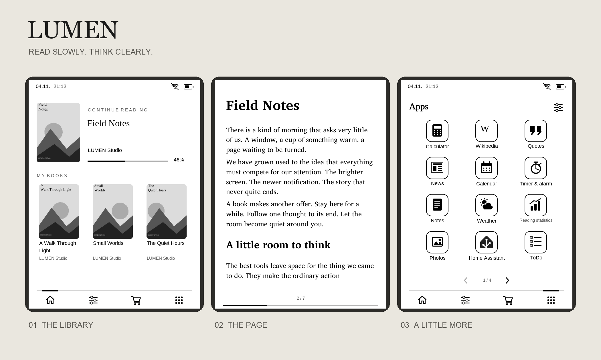
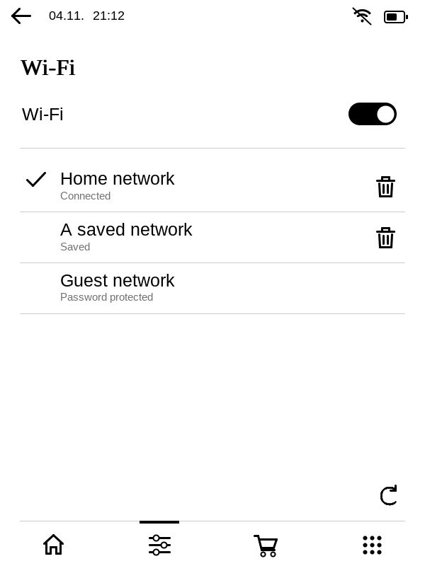
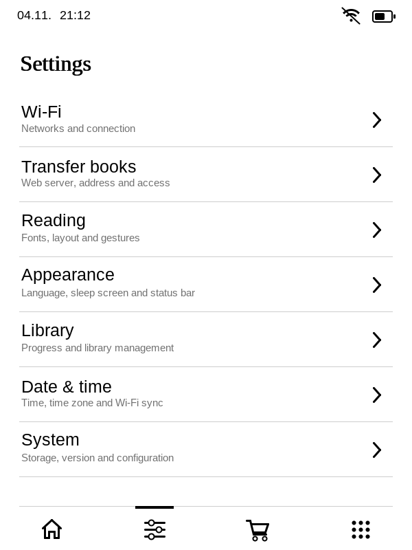
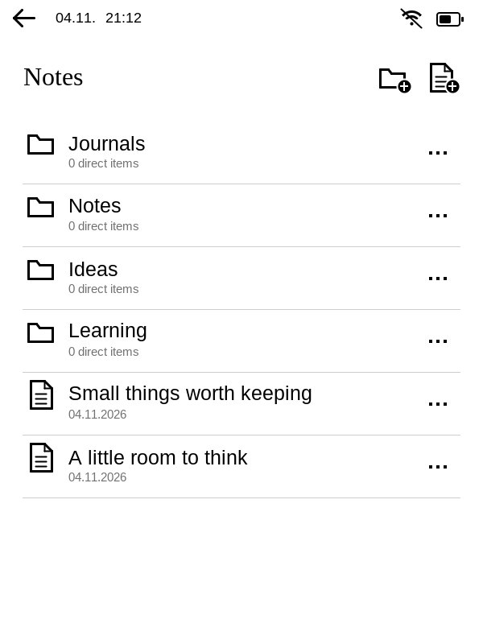
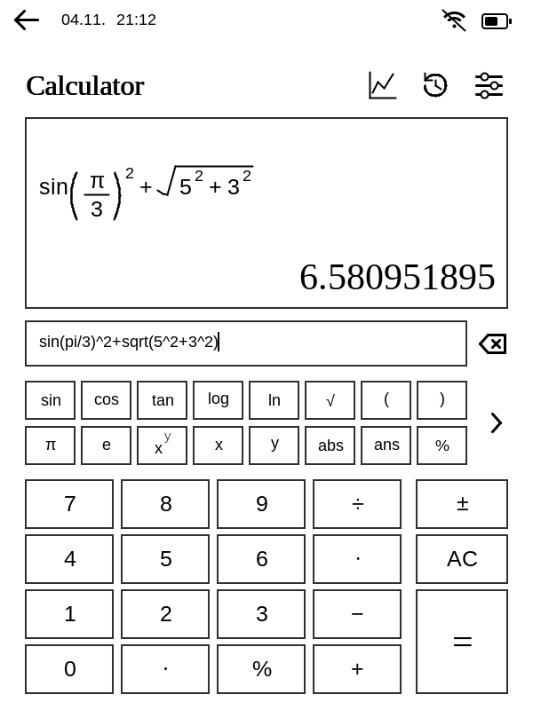
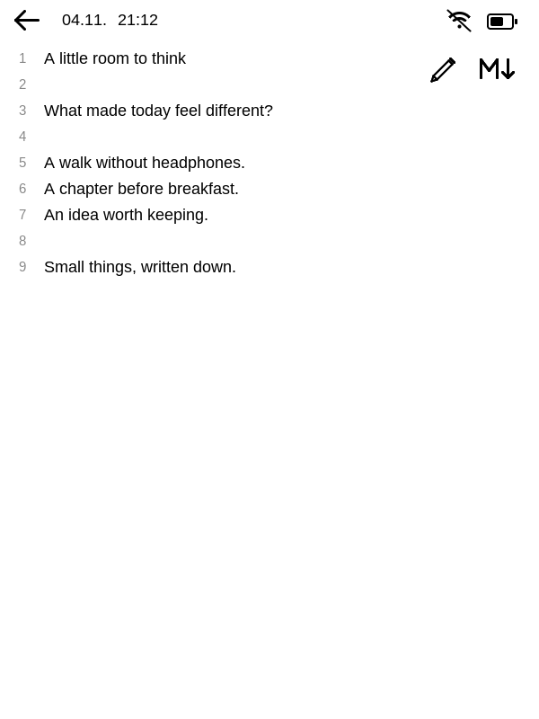
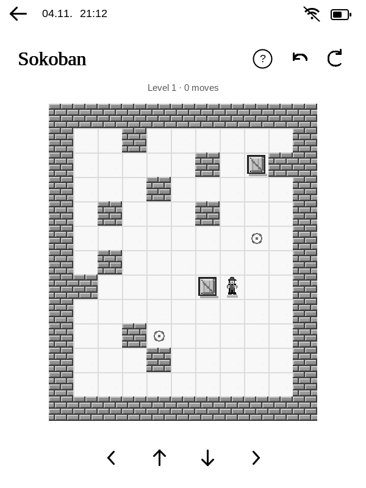
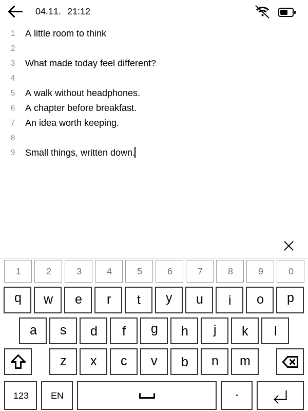

<div align="center">

# LUMEN

### A quieter kind of Kindle.

**A native, paper-like reading environment — with a little more room to think.**

[Download](https://github.com/MerlinHof/Lumen/releases/latest) ·
[Install](docs/installation.md) ·
[Build](docs/building.md) ·
[Architecture](docs/architecture.md) ·
[Agent guide](AGENTS.md)



`Native C` &nbsp; `Monochrome E-Ink` &nbsp; `Local first` &nbsp; `DE · EN · FR`

</div>

---

## New in 2.0

A quality and performance release: shared, carefully aligned list rows; quieter
rules; consistent form and title-bar spacing; corrected game actions; and a more
coherent Connect interface. Rendering does less work through exact glyph bounds,
faster antialiased rings and bounded RAM cover tiles, preserving image quality
and the established E-Ink refresh engine. No new apps or features.

<details><summary><strong>A consistent rhythm, from system settings to your notes</strong></summary>
<br>
<table><tr><td></td><td></td><td></td></tr></table>
</details>

## A small computer that knows when to be quiet

LUMEN gives a Kindle a clean library, an immersive reader and a collection of
thoughtful tools. Open a book. Write something down. Look up a word. Set a study
timer. Play a small puzzle. Then return to the page.

It is built around **clear typography, recognizable shapes and immediate touch
feedback**. No endless feed, no account required for local reading, and no need
to turn a monochrome device into a tiny imitation phone.

> **Current target:** Kindle Touch 2 · firmware **5.12.2.2** · ARMv7 · 600 × 800.
> LUMEN runs on prepared Kindle firmware. It does **not** jailbreak a stock device.
> Read the [installation requirements](docs/installation.md) before downloading.

## On the page, and beyond it

| Read & explore | Write & organize | A little more |
|---|---|---|
| Library with Continue Reading | Notes, folders, Markdown and ink | Scientific calculator and graphing |
| Shared configurable reader | Multiline ToDos and contexts | Weather and Home Assistant |
| Wikipedia and saved articles | Journaling and a local calendar | Timer, photos and planetarium |
| News, recipes and quotations | Flashcards and study tools | Chess, Sokoban, Sudoku and more |

Some online features depend on their providers and require Wi-Fi. Home Assistant
and OpenAI need your own configuration. The games and local tools do not require
an account. Protected Amazon formats are not universally readable; access to the
original Kindle reader remains available.

<table>
<tr>
<td align="center" width="33%"><br><b>Think clearly.</b><br>Typeset formulas, editable input and graphing.</td>
<td align="center" width="33%"><br><b>Leave a little space.</b><br>Notes, Markdown and drawings together.</td>
<td align="center" width="33%"><br><b>Play something small.</b><br>Detailed monochrome shapes, made for E-Ink.</td>
</tr>
</table>

<details>
<summary><strong>A closer look at input and settings</strong></summary>
<br>
<table><tr>
<td align="center"><br>Independent keyboard language, accents on long press, cursor editing and copy/paste.</td>
<td align="center"><br>Shared controls, compact selectors and one place for system preferences.</td>
</tr></table>
</details>

*Screenshots are native software renders using original demo content. They are
not hardware photographs or claims about measured E-Ink response time.*

## Install in a few steps

1. Prepare the supported Kindle with its compatible jailbreak and `.sh`
   launcher/FBInk installation.
2. Download and extract the [latest release](https://github.com/MerlinHof/Lumen/releases/latest).
3. Connect USB and run **Install-LUMEN.command** on macOS, or:
   ```sh
   python3 Install-LUMEN.py --kindle /path/to/Kindle
   ```
4. Wait for copy verification, safely eject, disconnect and open **LUMEN** once.

The first launch checks native EPUB rendering and installs autostart on the
supported firmware. Reader size starts at **24 px**; the Apps tab and automatic
time sync are enabled. Keyboard language is independent of system language.
Existing preferences and personal content survive updates.

**[Read the complete installation guide →](docs/installation.md)**

### Small runtime. Personal data stays personal.

The packaged runtime is approximately **28 MiB**; actual size is printed when
packaging. A Kindle's `lumen` folder also includes personal data, caches and old
rollback copies. The installer now retains **two recognized runtime backups**
after a successful update, while leaving unknown folders and user data alone.
No image, font or book quality is reduced.

## Build it yourself

```sh
git clone https://github.com/MerlinHof/Lumen.git
cd Lumen
python3 tools/setup.py host
python3 tools/build.py host
python3 tools/setup.py kindle
python3 tools/build.py kindle
python3 tools/check.py
python3 tools/package.py
```

The setup step fetches pinned official dependencies and verifies their checksums.
Subsequent builds are local and incremental. See [Build and develop](docs/building.md)
for prerequisites, testing, preview generation and the optional local HTTP check.

```text
Lumen/
├── src/
│   ├── system/       device, storage, networking, preferences, app runtime
│   │   └── ui/       shared shell, widgets, icons, keyboard and text editor
│   ├── apps/         application models and views
│   └── vendor/       credited embedded third-party code
├── device/           target launcher, autostart and internal rendering test
├── tools/            build, setup, checks, packaging and installer
├── scripts/          pinned dependencies and explicit source list
├── packaging/        explicit runtime allowlist and legacy cleanup hashes
├── tests/            synthetic fixtures and focused regression checks
├── docs/             guides and current native screenshots
└── licenses/         third-party license and attribution notices
```

Dependencies live in ignored `.local/`, outputs in `build/`, packages in `dist/`.
No compilers, copied release trees, device logs or private library reports are
part of the public source tree.

## A few honest boundaries

LUMEN is a substantial personal software project, not an official Amazon product
or a universal replacement firmware. Apps share one native process; older views
are still being separated into clearer modules. Host checks and simulated fresh
installs do not replace physical validation of sleep/wake, touch latency, battery
life or individual account integrations. See [Validation](docs/validation.md).

The calendar is local; Apple/Google cloud sync is not included. The timer is
visual and cannot wake deep sleep. Article images and available books depend on
the source. The basic language-learning and tools are intentionally small.

## Contributing with care

Start with **[AGENTS.md](AGENTS.md)** — it describes both the engineering rules and
the feeling of the project. Prefer one coherent shared component to several
slightly different implementations. Keep the reader central, preserve personal
files, and make the next action obvious on a slow monochrome screen.

## Credits & license

Developed in late 2026 by **GPT-6.1 Sol**, under the supervision, prompting and
license of **Merlin Hof**.

LUMEN is distributed under **[AGPL-3.0](LICENSE)**. Third-party notices are in
[licenses](licenses/), including MuPDF, fonts, libmobi, astronomy and scheduling
components. Home Assistant and Wikipedia identities belong to their respective
owners; no affiliation is implied.
